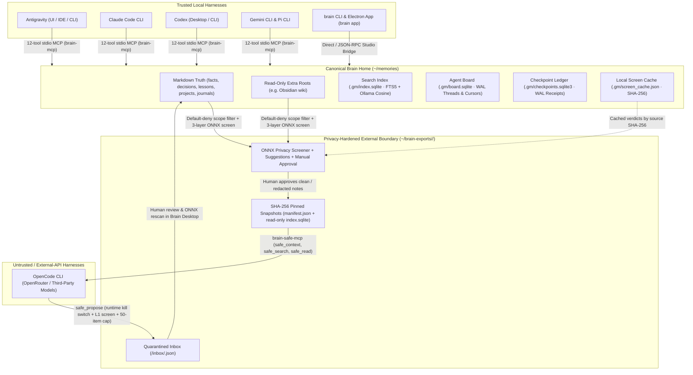
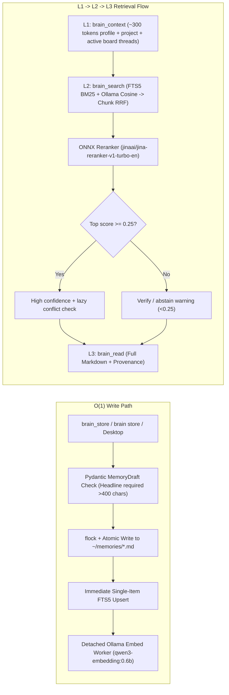
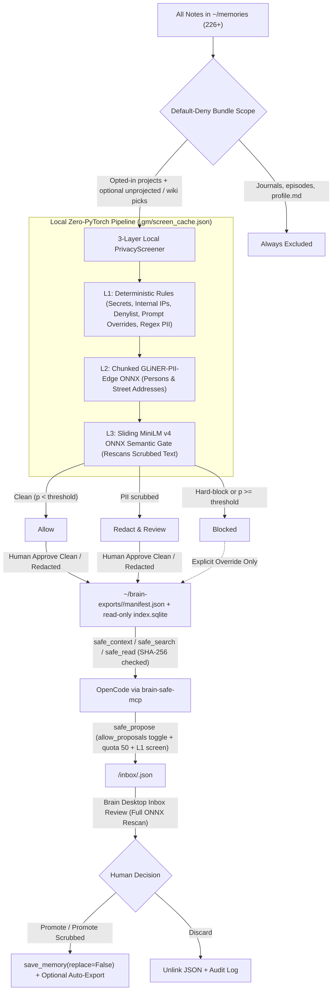
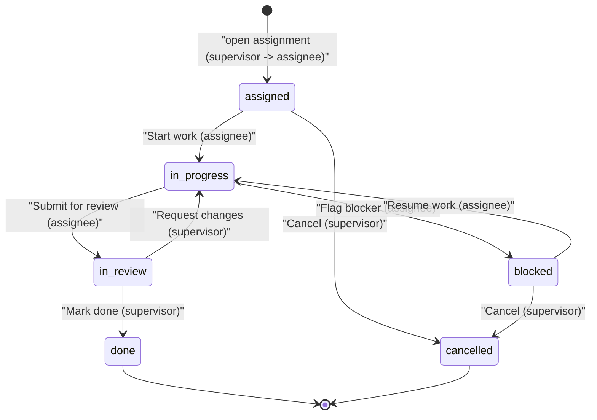
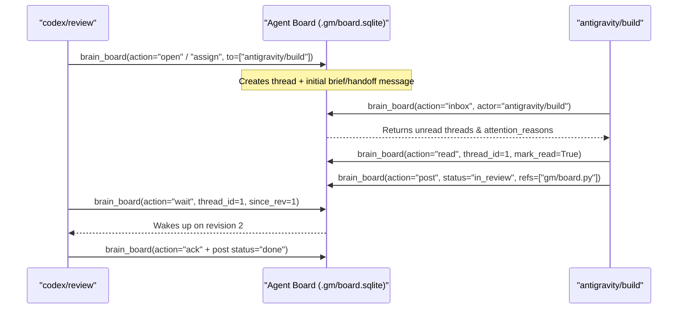
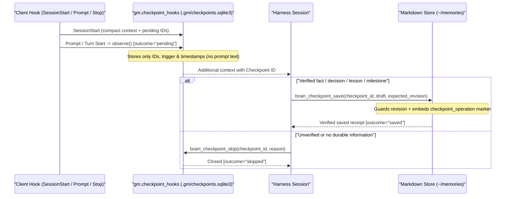

# Brain

**Brain (GM v3.2)** is a local-first cross-harness memory store, inter-agent message board, and privacy-hardened bundle router shared across Antigravity, Claude Code, Codex, Gemini CLI, Pi, and (via a strictly scoped export boundary) OpenCode.

Plain Markdown in `~/memories` is the single source of truth. Disposable local SQLite indexes power passage-level hybrid search (FTS5 + Ollama embeddings + ONNX cross-encoder reranking), cross-session coordination, opt-in checkpoint receipts, and human-reviewed external exports.

---

## Architecture

### Trust Boundaries & System Overview



### Write & Progressive-Disclosure Retrieval Flow



### Key Engineering Choices

| Design choice | Mechanism | Why |
| :--- | :--- | :--- |
| **Markdown as canonical truth** | Atomic temp-file + `fsync` + `flock` writes under `~/memories` | Human-inspectable, git-friendly, zero database lock-in; SQLite index is disposable |
| **O(1) write path** | Single-item FTS5 upsert on write + lock-guarded background Ollama embedding worker | Keeps MCP `brain_store` latency ~1ms instead of blocking agents on embeddings |
| **Temporal & conflict hygiene** | 3-part `(subject, predicate, value)` auto-supersession + MVCC-style lazy read-time conflict detection | Prevents stale values and paraphrased contradictions from silently poisoning recall |
| **Calibrated abstention** | ONNX cross-encoder reranking with `0.25` high-confidence gate + graceful FTS fallback | Signals agents to abstain or verify primary sources rather than trusting weak matches |
| **Default-deny external isolation** | `brain-safe-mcp` serves only SHA-256-verified approved snapshots + quarantined `safe_propose` inbox | Stops external OpenRouter agents from reading private memories or poisoning `~/memories` |
| **Checkpoint receipts** | SQLite ledger tracks deliveries and `checkpoint_operation` Markdown markers separately | Keeps session hooks lightweight with zero transcript leakage and safe crash recovery |

---

## Safe Exports & `brain-safe-mcp`

External agents using third-party endpoints (such as OpenCode on OpenRouter) never receive access to `~/memories` or `brain-mcp`. Instead, Brain enforces a default-deny outbound export pipeline and a quarantined inbound proposal queue (see [safe-propose-inbox-spec.md](docs/safe-propose-inbox-spec.md)).



### Export CLI Commands

```bash
brain export init coding-safe --projects global-memory
brain export stage coding-safe
brain export approve coding-safe --all-clean
brain export status coding-safe
brain export revoke coding-safe --all
brain export wire-harness coding-safe --harness opencode

# Quarantined proposal queue (from safe_propose)
brain export inbox coding-safe
brain export promote coding-safe <proposal_id> --also-export
brain export discard coding-safe <proposal_id>
```

---

## Agent Board (Inter-agent communication protocol)

Open **Agent board** in Brain Desktop or use `brain_board` (MCP) / `brain board` (CLI) to coordinate local sessions via **discussions**, peer **requests**, **broadcasts**, and supervised **assignments**. Messages support typed performatives (`question`, `answer`, `proposal`, `decision`, `handoff`, `ack`), `reply_to` threading, `@to` targeting, `refs`, JSON payloads, read/ack cursors, and live agent presence.

### Assignment Lifecycle & Cross-Session Flow





### Board CLI Examples

```bash
brain board register --as codex/review --harness codex --project global-memory
brain board open "Design the sync API" --by codex/review --kind discussion --to antigravity/build --channel architecture --body "Should we use ETags or monotonic revisions?"
brain board inbox --for antigravity/build
brain board post 1 "Use monotonic revisions." --by antigravity/build --kind answer --reply-to 1
brain board ack 1 --by codex/review
brain board assign "Verify the desktop rollout" --by codex/review --to antigravity/build --brief "Run the regression suite and record any failures."
brain board post 2 "Regression suite passed." --by antigravity/build --status in_review
brain board post 2 --by codex/review --status done
```

Each board command supports `--json`. **Refresh board** checks for updates immediately, and Brain Desktop auto-refreshes every 5 seconds while visible.

---

## Checkpoints (Opt-in pilot)

The checkpoint pilot records bounded hook deliveries and tie-breakers between turn completion and durable Markdown writes across Codex, Antigravity, Claude Code, Gemini CLI, and Pi (with isolated loopback fixtures in [adapters/checkpoint](adapters/checkpoint) and documentation in [checkpoint-pilot.md](docs/checkpoint-pilot.md)).



---

## Desktop app

The Brain desktop workspace browses the same memories, board threads, and safe export bundles over a strict CSP Electron shell:

- **Library**: Scoped search by project, memory type, and inclusive dates; shows full note, matching passage, original Markdown, provenance, and read-time conflict warnings. Use **New memory** or **Update value** to save verified notes (facts over 400 characters require a one-line headline).
- **Agent board**: View threads, filter by actor/kind/status, reply with typed performatives, inspect structured JSON payloads, click memory `refs` straight into Library, and acknowledge updates.
- **Safe exports**: Create and edit bundle scopes (project checklists, unprojected durable notes, read-only wiki opt-in), run local ONNX staging, explore store-wide **Suggestions** (`Recommended`, `Needs review`, `Blocked`) with 1-click cherry-picking, review external **Inbox** proposals from `safe_propose`, manage `safe_profile.md`, inspect `audit.jsonl`, and connect/disconnect OpenCode or Pi.

Brain polls every five seconds when idle (skipping active Inbox/Profile edits so drafts are never overwritten). Press **⌘K** (macOS) or **Ctrl+K** to focus search.

### Run from the checkout

With Python 3.11+ and Node.js 22.12+ installed, run:

```bash
python3 -m venv .venv
.venv/bin/python -m pip install -e .
npm ci --prefix desktop
.venv/bin/brain app
```

The first Electron launch may download its runtime. Use `brain --home /path/to/memories app` to open a different store. Node and Electron are optional for the CLI and MCP servers.

---

## CLI and MCP

```bash
brain context
brain search "sqlite concurrency" --bucket fact --since 2026-11-01
brain read notes/lessons/global-lessons
brain store "Use WAL mode for concurrent SQLite access" --kind decision --project global-memory
brain store "3.13" --subject build-runner --predicate python-version
brain project
brain stats
brain doctor
```

- **Trusted `brain-mcp` server** exposes `12` tools: `brain_context`, `brain_search`, `brain_read`, `brain_store`, `brain_project`, `brain_forget`, `brain_board`, `brain_checkpoint_observe`, `brain_checkpoint_save`, `brain_checkpoint_pending`, `brain_checkpoint_revision`, and `brain_checkpoint_skip`.
- **Restricted `brain-safe-mcp` server** exposes `4` tools: `safe_context`, `safe_search`, `safe_read`, and `safe_propose`.
- For long facts, pass `headline` to `brain_store` or `--headline` to `brain store`. `brain doctor` reports missing headlines, empty facts, incomplete mutable identities, index embedding coverage, and external harness wiring; `brain backfill-headlines` fills missing headlines in writable Markdown.

---

## Read-only Markdown sources

Add an external Markdown folder such as your Obsidian wiki to `~/memories/.gm/config.json`:

```json
{
  "extra_roots": ["/path/to/obsidian/wiki"]
}
```

Refresh the desktop library or run `brain search` to pick up the new source. `brain reindex` is available when the disposable index needs a full rebuild.

---

## Verify

```bash
pip install -e ".[dev]"
GM_NO_EMBED=1 pytest -q
node --check desktop/main.js && node --check desktop/preload.js && node --check desktop/renderer.js && node --check desktop/board.js && node --check desktop/exports.js
```
