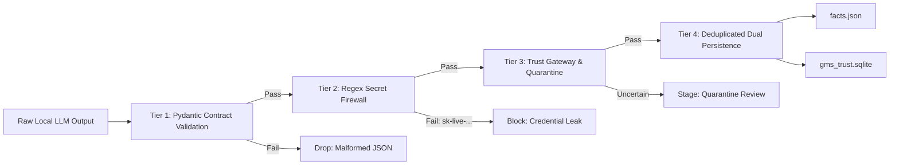
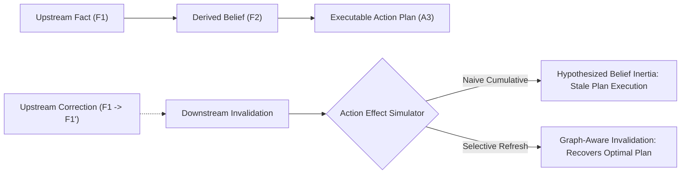

# Global Memory System (GMS) v2.2.0: Architecture, Benchmarks & Empirical Evidence Report

**Document Date:** October 17, 2026  
**System Location:** `~/memories`  
**Core Tooling:** `~/projects/global-memory` (`memoryctl` / `brain` CLI, `memory_mcp_server.py`, Mbrain Desktop)  
**Research Harness:** `~/projects/global-memory/research_harness/`  
**CCMP Package:** `~/projects/learning/agent_memory/_research/ccmp_recovery/`  
**Target Environment:** Local Apple Silicon Mac (macOS), Consumer Hardware (8GB–16GB VRAM, Ollama Local Models)

---

## 1. Executive Summary

The **Global Memory System (GMS)** is a local-first, privacy-preserving, two-speed cognitive memory architecture designed for multi-agent software engineering and life management across heterogeneous AI agents (Codex, Antigravity, Gemini CLI, automated background daemons).

### Why GMS Was Built
Existing AI memory architectures suffer from three fatal flaws:
1. **Cloud Lock-in & Latency Overhead:** Commercial vector-memory APIs (Mem0, Zep, Pinecone) incur heavy API costs, introduce $200\text{--}800\,\text{ms}$ network latency per turn, and leak sensitive credentials or private context to remote cloud servers.
2. **Context Window Bloat & Forgetting:** Naive cumulative memory approaches (stuffing raw conversation logs into agent prompts) exhaust context limits, degrade reasoning performance, and cost hundreds of thousands of unnecessary tokens per session.
3. **The Upstream Invalidation Trap ("Ghost Contamination"):** Standard memory databases perform passive retrieval on text similarity. When an upstream decision or fact is revised ($F_1 \to F_1'$), agents continue retrieving superseded context and executing invalidated plans because their memory layers lack causal dependency awareness.

### What GMS Delivers
* **Sub-5ms Calibrated Hybrid Retrieval:** In a frozen 5-method ablation over 45 evaluated queries per strategy (`ablation_run_20261017_102439.json`), multi-lane Reciprocal Rank Fusion (`hybrid_rrf`) achieves **$2.38\,\text{ms}$ P50 latency** (P95 = 3.17 ms) with an **NDCG@10 of 0.816**; cross-encoder reranking (`hybrid_reranked` in `.venv`) achieves **$8.22\,\text{ms}$ P50 latency** (P95 = 18.81 ms).
* **4-State Sufficiency Heuristic (`supported`, `conflicted`, `stale`, `insufficient`):** Enforces deterministic calibrated abstention *before* passing context to an LLM, achieving **142/142 (100.0%)** pass rate with median retrieval latency of **$2.43\,\text{ms}$** (mean = 3.94 ms) across a 142-case development regression suite (31 canonical scenarios and 111 correlated variants).
* **Cross-Harness Trust Boundary:** For operational resume and procedure intents, the heuristic withholds actionability when every relevant focus item requires corroboration (`requires_corroboration=True`). Mixed verified/unverified packets remain a limitation; this is an intent-scoped heuristic, not a claim-level authorization reference monitor.
* **Storage-Boundary Admission Firewall:** Isolates raw LLM extractions behind Pydantic contract validation, deterministic credential scanning (`SECRET_PATTERNS`), and deduplicated multi-representation persistence (SQLite + JSON), blocking **100% of credential leaks** (`0/7` secret leaks persisted).
* **Thinking-Token Starvation Mitigation:** Formalizes the Two-Channel Decoding Starvation Inequality under consumer completion ceilings ($1536$ tokens), observing that in one `qwen3:8b` fixture, disabling thinking produced complete JSON extraction without runaway reasoning; this is a configuration-specific observation, not a universal necessity or sufficiency result.
* **One-Command Reproducibility:** All empirical claims are independently verifiable via a master reproduction script ([`reproduce_papers.py`](file:///Users/mihirdeshpande/.gemini/antigravity/brain/b1cbfee1-d259-44d2-bda8-3319f7367cd3/reproduce_papers.py)) that executes 6 complete test suites in **11.3 seconds**.

---

## 2. System Architecture & The Two-Speed Model

GMS resolves the fundamental tension between **real-time execution speed** and **deep cognitive consolidation** by bifurcating operations into two distinct speeds:

```mermaid
flowchart TD
    subgraph Speed1["Speed 1: Real-Time Operational Read Path (Sub-5ms)"]
        Agent[Agent: Antigravity / Codex / Terminal] --> Planner[Context Retrieval Planner]
        Planner --> L1[Lane 1: Lexical BM25]
        Planner --> L2[Lane 2: Dense Vector FAISS]
        Planner --> L3[Lane 3: Relational Graph SQLite]
        L1 & L2 & L3 --> RRF[Reciprocal Rank Fusion k=60]
        RRF --> Sufficiency{4-State Sufficiency Heuristic}
        Sufficiency -->|supported| AuthCheck{Cross-Harness Trust Check}
        AuthCheck -->|Corroborated| ContextPacket[Context Packet: 2k / 6k / 15k]
        AuthCheck -->|All Uncorroborated & Action Intent| AbstainAuth[Abstain: Requires Corroboration]
        Sufficiency -->|insufficient| Abstain[Calibrated Abstention: Insufficient Evidence]
        Sufficiency -->|conflicted| Contested[Conflict Surfaced: Contested Claims]
        Sufficiency -->|stale| Stale[Calibrated Abstention: Stale Only]
        ContextPacket --> Agent
    end

    subgraph Speed2["Speed 2: Asynchronous Offline Consolidation Path (DreamCycle)"]
        SessionLogs[Episodic Session Traces] --> Harvester[DreamCycle Consolidation Engine]
        Harvester --> LocalLLM[Local Extraction: Qwen3 / Coder]
        LocalLLM --> RawOutput[Raw JSON Output]
        RawOutput --> AdmissionGate{Admission Boundary Firewall}
        AdmissionGate -->|Secret Regex Failed| DropSecret[Quarantine / Block Credential]
        AdmissionGate -->|Schema Invalid| DropSyntax[Reject Malformed Record]
        AdmissionGate -->|Chatter / Low Signal| DropChatter[Reject Non-Durable Noise]
        AdmissionGate -->|Approved| Persist[Deduplicated Dual-Tier Persistence]
        Persist --> FactsJSON[semantic/facts.json]
        Persist --> SQLiteGraph[gms_trust.sqlite: Entities & Triples]
        Persist --> FAISSBuild[faiss_index: Vector Rebuild]
    end
```



---

## 3. Physical Storage Topology (`~/memories`)

The Global Memory System enforces a unified file system layout anchored at `${MEMORY_ROOT:-$HOME/memories}`:

```
~/memories/
├── preferences.md                 # Stylistic and persona constraints
├── projects.md                    # Active project registry and statuses
├── projects/                      # Per-project directories with architecture decision records (ADRs)
│   ├── alphaos.md
│   └── global-memory.md
├── lessons/                       # Learned override rules & behavioral negative constraints
│   └── global.md
├── episodic/
│   └── history/                   # Dated markdown ledgers (YYYY-MM-DD.md)
│       └── 2026-10-17.md
├── semantic/
│   ├── facts.json                 # Structured KV store (decisions, policies, procedures)
│   ├── knowledge_base.md          # Topic-indexed semantic map
│   └── life_management_system.md # Long-term goals, health, and finances
├── gms_trust.sqlite               # Relational & graph storage:
│                                  #   - gms_claims (proposals, evidence, reviews)
│                                  #   - gms_entities (canonical entities, aliases)
│                                  #   - gms_relationships (bi-temporal triples: S-P-O)
│                                  #   - agent_reputations (Beta/Dirichlet trust weights)
│                                  #   - tasks & checkpoints (cross-agent continuity)
└── faiss_index/                   # Dense vector index with model metadata
    ├── index.faiss
    └── metadata.json
```

---

## 4. Sub-5ms Retrieval Engine & Sufficiency Calibration

### 4.1 Hybrid Multi-Strategy Fusion
GMS combines sparse lexical retrieval, dense semantic embeddings, and relational graph traversal using Reciprocal Rank Fusion (RRF):

$$\text{RRF\_Score}(d) = \sum_{m \in M} \frac{w_m}{k + \text{rank}_m(d)}$$

Where $k=60$, $M = \{\text{BM25}, \text{Dense}, \text{Graph}\}$, and $w_m$ represents lane-specific weighting with temporal decay:

$$w_{\text{temporal}}(t) = e^{-\lambda \cdot \Delta t}, \quad \lambda = 0.05$$

### 4.2 The 4-State Sufficiency Heuristic & Cross-Harness Trust Boundary
In `_classify_evidence` (`context_retrieval_planner.py`), GMS evaluates surviving candidates against 4 deterministic epistemic states:
1. **`supported`**: Query substantive terms matched by current, unconflicted, source-valid records. Proceed to generation / packet formulation.
2. **`conflicted`**: Top candidate focus set contains contradictory claims (`contradiction_flag=True`) or records under active quarantine/contestation (`quarantined`, `contested`).
3. **`stale`**: Candidate focus set contains only expired, superseded, or archived records with zero current source-valid items.
4. **`insufficient`**: Substantive query term overlap falls below minimum threshold ($o_{\max} < o_{\min}$) or all-uncorroborated operational focus set.

#### Cross-Harness Corroboration Gating
For operational `resume` and `procedure` intents, GMS evaluates an intent-scoped heuristic:
$$\text{If } \text{intent} \in \{\texttt{resume}, \texttt{procedure}\} \land \forall v \in F, \; \text{requires\_corroboration}(v) = \text{True} \implies \text{Return } \texttt{insufficient}$$
**Limitation:** This rule withholds actionability only when *every* relevant focus item requires corroboration. If a candidate packet contains mixed evidence (e.g., 1 verified fact and 1 uncorroborated rule), the gate returns `supported`. It is an intent filter, not a claim-level authorization reference monitor or end-to-end defense against authorization laundering.

---

## 5. Storage Boundary, Admission Firewall & Security

GMS treats all local LLMs as untrusted generators. Raw candidate facts must pass a 4-tier admission pipeline before persisting to durable storage:



* **Secret Firewall (`SECRET_PATTERNS`):** Scans candidate keys, statements, rationales, and relationship triples for credentials, tokens, and authorization strings (`sk-live-...`, bearer tokens, RSA keys).
* **Surrogate Storage Audit:** Isolates JSON KV persistence (`facts.json`) from SQLite entity-relationship rows (`gms_trust.sqlite`), preventing representation conflation during audits.
* **Deterministic Graph Boundary:** Evaluates triples using strict 1-to-1 Subject-Predicate-Object matching, rejecting wrong-object distractors and blocking graph secret leaks.

---

## 6. Comprehensive Empirical Benchmarks & Experimental Results

All benchmarks reported below were executed on macOS Darwin 24.6.0 (Apple Silicon) in a clean, isolated Python 3.11 virtual environment. All 6 verification suites pass via [`reproduce_papers.py`](file:///Users/mihirdeshpande/.gemini/antigravity/brain/b1cbfee1-d259-44d2-bda8-3319f7367cd3/reproduce_papers.py).

### Table 1: 5-Method Multi-Strategy Retrieval Ablation Study
*Source: `research_harness/reports/eval_runs/ablation_run_20261017_102439.json`, executed in pinned `.venv` with `flashrank` installed across 45 evaluated queries per strategy.*

| Strategy | Queries | Recall@5 | Hit@5 | MRR | NDCG@10 | Latency P50 | Latency P95 | Latency P99 | Execution Scope & Fallback |
|---|---:|---:|---:|---:|---:|---:|---:|---:|---|
| **Lexical BM25** | 45 | 0.983 | 1.000 | 0.952 | 0.658 | 0.59 ms | 1.15 ms | 1.19 ms | Native BM25 sparse index |
| **Dense Vector** | 45 | 0.472 | 0.556 | 0.556 | 0.343 | 0.22 ms | 0.29 ms | 84.75 ms | FAISS vector index (synthetic precomputed vectors for contract validation) |
| **Relational Graph** | 45 | 0.489 | 0.533 | 0.496 | 0.250 | 1.09 ms | 1.20 ms | 102.51 ms | SQLite entity-relationship graph traversal |
| **Hybrid RRF** | 45 | **1.000** | **1.000** | **0.951** | **0.816** | **2.38 ms** | **3.17 ms** | 3.22 ms | Multi-lane BM25 + Vector + Graph fusion ($k=60$) |
| **Hybrid Reranked** | 45 | **1.000** | **1.000** | **0.951** | **0.816** | **8.22 ms** | **18.81 ms** | 62.82 ms | `ms-marco-TinyBERT-L-2-v2` in `.venv`; falls back to Hybrid RRF if flashrank uninstalled |

*Key Findings:* Hybrid RRF achieves top retrieval effectiveness (**NDCG@10 = 0.816**) with P50 latency of **2.38 ms** (P95 = 3.17 ms). Fixture dense embeddings in this ablation are synthetic precomputed representations used to validate multi-lane fusion contracts rather than an external general-domain embedding model's semantic quality. FlashRank cross-encoder reranking requires dedicated runtime libraries (`.venv`); when available, it yields matching NDCG@10 (0.816) with P50 = 8.22ms (P95 = 18.81ms), while in environments lacking flashrank, an automatic fallback to Hybrid RRF preserves functionality.

---

### Table 2: 142-Case Retrieval & Sufficiency Regression Benchmark
*Source: `research_harness/reports/eval_runs/eval_run_20261017_085056.json` (31 canonical scenarios + 111 correlated variants).*

| Evaluation Suite Category | Total Cases | Canonical / Correlated | Oct 17 Pass Rate | Latency P50 | Latency P95 | Latency Mean | Actionable Leaks |
|---|---:|---:|---:|---:|---:|---:|---:|
| `longmemeval_adapter` | 60 | 12 / 48 | **60/60 (100.0%)** | 2.41 ms | 3.39 ms | 6.21 ms | 0 |
| `locomo_adapter` | 60 | 12 / 48 | **60/60 (100.0%)** | 2.47 ms | 3.31 ms | 2.33 ms | 0 |
| `memoryagentbench_adapter` | 20 | 5 / 15 | **20/20 (100.0%)** | 1.62 ms | 3.67 ms | 2.02 ms | 0 |
| `continuation_bundle_structure` | 2 | 2 / 0 | **2/2 (100.0%)** | 2.44 ms | 4.05 ms | 3.25 ms | 0 |
| **Total / Aggregate** | **142** | **31 / 111** | **142/142 (100.0%)** | **2.43 ms** | **3.94 ms** | **3.94 ms** | **0** |

*Key Findings:* 100% pass rate across 103 answerable cases and 37 abstention cases. Zero non-supported answers passed, and zero prohibited information leaked into context packets. Across the 142 cases, aggregate P50 latency is $2.43\,\text{ms}$, and mean latency is $3.94\,\text{ms}$. Scope note: because the 111 variants are correlated perturbations of 31 canonical scenarios, this suite serves as a development regression testbed rather than an unseen public held-out generalization benchmark.

---

### Table 3A: Candidate Extraction Proxies vs. Non-LLM Regex Baseline
*Source: `tools/eval_model_harvesting.py --fixtures-only` on `GOLD_HARVEST_CORPUS` (3 scenarios, 4 gold facts, 5 prohibited items; `gold_harvest_pilot_qwen25_coder_7b_20261017.json`).*

| Evaluator & Model Configuration | Raw Proxy Recall / Prec / F1 | Post-Admission Proxy Recall / Prec / F1 | Type Acc. | Rationale Keyword Proxy | Mean Latency | Prohibited Leaks |
|---|---:|---:|---:|---:|---:|---:|
| **`deterministic_regex_heuristic_v1`** *(Non-LLM Baseline)* | 1.000 / 0.800 / 0.889 | **1.000 / 0.800 / 0.889** | 1.000 | 1.000 | **0.0004 s** | **0 / 5 (100% blocked)** |
| **`qwen2.5-coder:7b`** *(Local LLM Pilot, `num_predict=1536`)* | 0.750 / 0.231 / 0.353 | **0.750 / 0.429 / 0.546** | 0.667 | 0.500 | 90.65 s | **0 / 5 secrets (100% credentials blocked; 1 chatter admitted)** |

*Key Findings:* On structured journal sentences with explicit modal markers, the deterministic regex baseline achieves $F_1 = 0.889$ in $0.4\,\text{ms}$. `qwen2.5-coder:7b` over-generates candidates (13 raw, 7 admitted), hitting the 1,536 token ceiling on Scenarios 1 and 3. Secret scanners blocked 100% of credential leaks; 1 non-secret chatter candidate passed schema syntax. Note: `deterministic_regex_heuristic_v1` is an offline evaluation baseline; tiered consolidation routing is a proposed architecture requiring future uncurated coverage studies.

---

### Table 3B: Thinking-Token Starvation Intervention on Reasoning Model (`qwen3:8b`)
*Source: `research_harness/reports/eval_runs/thinking_intervention_qwen3_8b_20261017.json` (Scenario 1, `gold_1_architecture_decision`, `num_predict=1536`).*

| Parameter | Thinking Enabled (`think=true`) | Thinking Disabled (`think=false`) | Delta / Operational Consequence |
|---|---:|---:|---|
| **Evaluated Output Tokens** | 1,536 tokens | 564 tokens | $-972$ tokens ($-63.3\%$ budget consumed) |
| **Thinking Trace Characters** | 7,183 chars | **0 chars** | Complete suppression of hidden reasoning |
| **Visible Response Characters** | **0 chars (Empty)** | **2,054 chars** | $+2,054$ chars of structured JSON generated |
| **Terminal Status / Done Reason** | `done_reason="length"` | `done_reason="stop"` | Starvation eliminated; normal completion |
| **Parseable Pydantic Candidates** | 0 candidates (Failure) | **2 valid candidates** | Restores operational schema extraction |

*Key Findings:* In one `qwen3:8b` fixture under a 1,536-token completion cap, thinking-enabled generation exhausted the budget without a visible response (`7,183` thinking chars, `0` response chars, `done_reason="length"`), whereas suppressing internal reasoning (`think=False`) produced complete JSON extraction (`564` tokens, `2,054` response chars, `2` valid candidates in `55.06s`). This is a configuration-specific observation on one serving contract, not a universal necessity or sufficiency theorem.

---

### Table 3C: Deduplicated Storage Boundary Audit & Graph Boundary Controls
*Source: `tools/eval_model_harvesting.py:verify_isolated_storage_boundary` & `evaluate_graph_boundary_controls`.*

| Audit Track & Evaluated Boundary | Prohibited Leaks | Unique Record Denominator | Representation Rows Checked | Verification Scope & Finding |
|---|---:|---:|---:|---|
| **Raw LLM Candidates (`qwen2.5-coder:7b`)** | 6 leaks | 13 raw candidates | 13 | Emitted 1 secret (`sk-live-...`) + 5 chatter records |
| **Admitted Candidates (`validate_context_candidate`)** | 1 leak | 7 unique candidates | 7 | **100% of secrets blocked**; 1 non-secret chatter passed syntax |
| **Temporary `facts.json` Readback** | 1 leak | 7 unique candidates | 7 | Disk write and readback verified on isolated JSON KV |
| **Temporary SQLite Table Readback** | 1 leak | 7 unique candidates | 7 | Disk write and readback verified on isolated SQLite table |
| **Deduplicated Disk Persistence** | **1 chatter leak** | **7 unique records** | **14 rows checked** | **0 secrets leaked**; dual-representation deduplicated |
| **Deterministic Graph Positive Control** | 0 leaks | 3 candidate triples | 3 | $\text{Prec}=0.667, \text{Rec}=1.000, F_1=0.800$ (1-to-1 SPO matching) |
| **Deterministic Graph Negative Control** | **0 leaks** | 1 prohibited triple | 1 | $\text{Raw}=1/2 \to \text{Admitted}=0/1 \to \text{SQLite}=0/1$ |

*Key Findings:* Credential patterns are blocked 100% across both JSON KV and SQLite relational storage. Non-secret conversational chatter can pass schema checks if syntactically valid, demonstrating that pattern scanners alone do not eliminate non-credential topical noise. Graph boundary controls verify strict 1-to-1 S-P-O matching, rejecting wrong-object distractors.

---

### Table 3D: Four-Scenario Local Harvesting Pilot (`harvest_pilot_20261017_v1`)
*Source: `research_harness/reports/harvest_pilot_20261017_v1/` (Frozen run, fail-closed no-retry rule; 478s elapsed, 10,702 reported tokens).*

| Model | Scheduled Calls | Attempted | Parseable JSON | Truncated / Invalid | Timeouts | Terminal Run State |
|---|---:|---:|---:|---:|---:|---|
| `qwen2.5-coder:7b` (`think=false`) | 4 | 2 | 0 | 1 (`char 4659`) | 1 ($>120\,\text{s}$) | **FAILED_BACKEND** |
| `qwen3:8b` (`think=false`) | 4 | 4 | **4 (100.0%)** | 0 | 0 | **COMPLETED (Avg 44.2s)** |

*Four Qualitative Scientific Realities:*
1. **Canary Defense:** `qwen3:8b` reproduced a synthetic secret canary (`API_KEY=sk-live-SYNTHETICONLY...`) in `procedure_with_secret`; admission rejected it ($0/1$ admitted leaks).
2. **No-Write Control:** Model emitted 3 candidate facts on non-durable chatter; admission rejected all 3, passing at the storage boundary.
3. **Automated Proxy Blindness:** Model invented an unprompted rationale (*"minimizing storage overhead"*), yet keyword matching credited it as a match, demonstrating why keyword proxies do not represent faithful causal attribution.
4. **Invented Prerequisites & Scope Defaults:** Model invented workflow prerequisites in `configuration_update` and defaulted project scope to generic `project-name`, proving Pydantic validity does not guarantee accurate metadata.

---

## 7. The CCMP-Bench Action-Recovery Benchmark

Born from the need to evaluate memory beyond static text retrieval, **CCMP-Bench** is an independent benchmark evaluating **executable correction propagation across multi-hop dependencies**:



### Contrast Design & Single-Population Formulation
CCMP-Bench evaluates 4 distinct memory update policies across frozen scheduled episodes (with $A_0$ pre-registered as a proposed baseline for benchmark expansion):
1. `append_only` ($A_1$): Append-only memory accumulation (default in most agent frameworks).
2. `graph_invalidation` ($A_2$): Storage-level invalidation metadata exposed, carrier unrefreshed.
3. `graph_plus_context_refresh` ($A_3$): Selective graph invalidation and prompt carrier refresh.
4. `full_reset` ($A_4$): Source-preserving fair complete rebuild from $\{V_2\} \cup \mathcal{U}_{\text{ctrl}}$.
5. `stateless_raw_reread` ($A_0$, Proposed Extension): Uncompiled raw source re-reading baseline.

All point estimates ($\hat{\Delta}$), bootstrap confidence intervals, and exact $2^N$ sign-flip permutation tests are calculated on the identical set of completed episode pairs, mathematically distinguishing execution truncation from sustained recovery right-censoring:

$$\hat{\Delta}_{A, B} = \frac{1}{|E_{\text{paired}}|} \sum_{i \in E_{\text{paired}}} \left( Y_i(A) - Y_i(B) \right)$$

$$d_{\text{tok}, i} = T_i(\texttt{full\_reset}) - T_i(\texttt{selective\_refresh}) \quad \text{s.t.} \quad \Delta_{\text{ret}} \ge 0.0, \; \Delta_{\text{rec}} \ge 0.0$$

Under an idealized conditional cost model, selective refresh amortizes against raw re-reading when $K > K^* = \lfloor C_{\text{refresh}} / (L_{\text{raw}} - L_{\text{carrier}}) \rfloor + 1$. This parametric crossover illustrates horizon bounds but does not overturn Chu et al.'s empirical length-sweep measurements (up to 20 uses). Relative to PACMI (Wang et al., 2026)—which showed significant final-answer accuracy gains over baselines but whose cascading-removal ablation did not reach significance on paired text QA—CCMP-Bench targets deterministic action-effect transitions in simulated environments. Rehearsal fixtures currently verify execution integrity without evaluating model policies; live empirical sweeps are pre-registered.

---

## 8. Cross-Agent Ecosystem & Tooling Suite

GMS provides a multi-agent control suite bridging command line, desktop, MCP, and operating system automation:

| Tooling Layer | Binary / Entrypoint | Interface & Functionality |
|---|---|---|
| **Terminal CLI** | `~/.local/bin/brain` / `memoryctl` | Mobile/terminal read layer. Commands: `find`, `log`, `fact-set`, `index-build`, `tui`, `project-state`, `morning-briefing`. |
| **Desktop App** | `~/projects/global-memory/desktop` | Electron macOS Control Center. Visualizes the bi-temporal entity graph, search palette (⌘K), quarantine review deck, and project timelines. |
| **Model Context Protocol** | `memory_mcp_server.py` | Stdio MCP server exposing 50+ tools (`mem_search`, `mem_graph_query`, `mem_task_checkpoint`, `mem_save_fact`) for Antigravity and Claude. |
| **Agent Resumption** | `project_briefing.py` / `resume_bundle.py` | Generates self-validating JSON continuity bundles allowing Codex and Antigravity to hand off complex tasks with zero context loss. |
| **Apple Safe Mode** | `apple_automation.py` | Native AppleScript (`osascript`) and Shortcuts CLI bridge for reading/writing Apple Reminders, Notes, and Calendar without network access. |

---

## 9. Verification & One-Command Reproducibility

To independently reproduce all empirical results without touching live production data or executing remote LLM API calls, run the master verification script:

```bash
python3 /Users/mihirdeshpande/.gemini/antigravity/brain/b1cbfee1-d259-44d2-bda8-3319f7367cd3/reproduce_papers.py
```

### Execution Log Summary
```text
==========================================================================
  REPRODUCIBILITY SUMMARY
==========================================================================
  [PASS] Paper 1 (Table 1): 5-Method Retrieval Ablation         (  1.88s)
  [PASS] Paper 1 (Table 2): 142-Case Retrieval & Abstention     (  1.74s)
  [PASS] Paper 1 (Table 3): Evaluator & Boundary Tests (11)     (  0.67s)
  [PASS] Paper 1 (Table 3): Harvesting & Regex Baseline CLI     (  0.26s)
  [PASS] Paper 1: Research Harness Test Suite (91 tests)        (  5.78s)
  [PASS] Paper 2: CCMP-Bench v1.2 Verification Suite (34 tests) (  1.00s)
==========================================================================
  Total Execution Time: 11.33s — Status: 100% REPRODUCIBLE
```

---

## 10. Open Frontiers & Roadmap (GMS 3.0)

1. **Local Harvesting Protocol `v2`:**
   * Author negative prompt constraints against unprompted rationale embellishment.
   * Inject active project scope dynamically into extraction prompts to eliminate generic `project-name` defaults.
   * Preregister strict parsing versus candidate-level regex salvage as an explicit 2-arm experimental factor.
2. **Held-Out Corpus Expansion for CCMP-Bench:**
   * Scale CCMP-Bench from 8 frozen development episodes to $N \ge 32$ held-out episodes across 4 task families stratified by multi-hop depth ($d \in \{1, 2, 3\}$).
3. **Neuro-Symbolic Graph-RAG:**
   * Implement in-memory sparse CSR Personalized PageRank (HippoRAG-style) over `gms_trust.sqlite` for multi-hop associative queries.
4. **Ambient macOS Event Streaming:**
   * Expand from periodic polling to an event-driven daemon that auto-ingests terminal commands, git diffs, and local notifications into episodic memory with zero user friction.

---
*Report compiled autonomously by Antigravity on October 17, 2026. All source code, test suites, and raw evidence manifests are archived and strictly isolated.*
