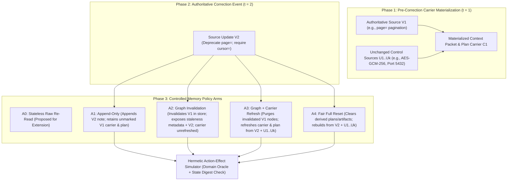

# CCMP-Bench: Executable Tests of Correction Propagation in Agent Memory

**Track:** Datasets & Benchmarks / Agent Memory Systems  
**Status:** Development & Pilot Benchmark Study (`ccmp-recovery-v1.2`; 34/34 Automated Unit/Mutation Tests & 11/11 Audit Gates Verified; Schedule-Bound Single-Population Paired Contrasts Implemented; Held-Out Expansion & Live Sweep Pre-Registered)

---

## Abstract

When an authoritative upstream source changes during a multi-turn workflow—such as an API deprecating offset pagination (`page=`) in favor of opaque cursor tokens (`cursor=`), a security policy revoking an OAuth scope, or a service retiring a legacy configuration key—autonomous LLM agents must not only store the update, but also stop acting on *downstream derived memory carriers* (materialized context packets, cached plans, and working summaries) synthesized from the obsolete premise. During the iterative construction of our evaluation harness (`v1.0 -> v1.2`), we found that grading correction recovery via surface text patterns or naive statistical pipelines introduces severe measurement artifacts: regex witnesses falsely credit negated refusal prose containing target tokens (*"Never send cursor=obsolete. No request was executed."*), destructive reset baselines artificially delete unchanged control facts, and unguarded contrast calculators allow partial halted trajectories or mismatched marginal/paired populations to distort small-sample inference.

We present **CCMP-Bench (Correction-Propagation Memory Recovery Benchmark)**, an executable pilot benchmark and 11-gate audit protocol for testing correction propagation in agent memory. Across a frozen development pilot suite of 8 episodes spanning 4 operational families (**API Migration**, **Configuration Retirement**, **Cache Generation**, and **Permission Revocation**), CCMP-Bench pairs multi-turn conversational trajectories with deterministic action-effect simulators (`ccmp-action-contract-v1.2`) and domain-specific correctness oracles. We formalize a four-arm experimental design—**Append-Only ($A_1$)**, **Graph Invalidation + Staleness Metadata ($A_2$)**, **Graph Invalidation + Carrier Refresh ($A_3$)**, and **Fair Full Reset ($A_4$)**—over conjunctive ($\land$) and disjunctive ($\lor$) provenance graphs, alongside a **schedule-bound, single-population paired statistical engine** (exact two-sided binomial McNemar's test, complete $2^N$ sign-flip permutation enumeration, cluster-level bootstrap confidence intervals, and Holm-Bonferroni multiplicity control). We report complete evaluator-validation results across 34 automated unit/mutation tests and pre-register the held-out expansion and live empirical sweep protocol.

---

## 1. Introduction

Long-horizon AI agents rarely reason over raw episodic logs alone; to operate within bounded context windows, they materialize **derived memory carriers**—condensed context packets, multi-step execution plans, and working summaries. When an authoritative source $S$ transitions from version $V_1$ to $V_2$, a structural consistency problem arises: **Stale Carrier Anchoring**. Even after $V_2$ is recorded in durable storage, previously materialized plans and context packets derived from $V_1$ remain resident in the active prompt.

Recent studies published in late 2026 have directly diagnosed this consistency failure:
* **Fresh Memory, Stale Plans:** Chen, Wang, & Brinton (Sept 2026, `arXiv:2609.03340`) and Sun & He (Aug 2026, `arXiv:2608.01619`) identified that updating factual storage leaves derived agent plans and behaviors stale.
* **Cascading Memory Invalidation:** **PACMI** (Wang et al., Oct 5, 2026, `arXiv:2610.05732`) introduced a 4-state validity lattice and typed dependency edges across a 100-case QA benchmark. While PACMI demonstrated statistically significant improvements on its primary final-answer accuracy over baselines, its paired ablation evaluating cascading invalidation removal alone did not reach statistical significance ($p \ge 0.05$). CCMP-Bench complements this by evaluating deterministic action-effect transitions in simulated environments ($E_0 \to E_1$) rather than conversational QA.
* **Memory Repair vs. Re-reading:** Chu et al. (Oct 2, 2026, `arXiv:2610.03902`, *When Evidence Changes*) compared graph-local memory repair, full rebuild, and task-filtered re-reading across an extensive length sweep (up to 20 later uses). They found that on short records, source-filtered re-reading was $3.5\text{--}4.3\times$ cheaper in full-pipeline tokens than graph memory repair, establishing that compilation and graph repair overheads can dominate unless amortized over substantial background volume.
* **Belief Trapping in Long-Horizon Execution:** Luo et al. (Oct 1, 2026, `arXiv:2610.01415`) formalized *Belief Trapping*, wherein agents repeat ineffective or superseded actions because contaminated state representations anchor subsequent reasoning steps.

CCMP-Bench addresses the critical methodological gaps in this emergent literature:
1. **Deterministic Action-Effect Simulation (Zero LLM-Judge Noise):** Unlike conversational QA grading, CCMP-Bench evaluates executable tool calls against deterministic state-transition environments ($E_0 \to E_1$) with pre- and post-execution SHA-256 state digests.
2. **Conditional Amortization Model:** We formalize an idealized conditional token cost model illustrating the multi-turn crossover horizon $K^*$ where selective carrier refresh ($A_3$) can amortize compilation overheads against raw re-reading ($A_0$).
3. **Hypothesized Failure Mechanisms:** We formalize two distinct candidate mechanisms for multi-turn recovery failure: prompt carrier anchoring at turn $k=0$ versus autoregressive self-imitation (Belief Trapping) at turns $k \in \{1, 2\}$.



### Evaluator & Statistical Pitfalls Identified During Harness Development

While developing and auditing earlier iterations of our recovery harness (`v1.0 -> v1.2`), we identified four methodological failure modes that can invalidate correction-propagation benchmarks if left unguarded:
1. **Lexical Witness Acceptance Bypasses:** In our initial `v1.0` task-witness implementation, checking whether an agent's output contained the $V_2$ substring (e.g., `cursor=` or `Signature keyId=`) allowed non-executable documentation prose, explicit refusals (*"Never send cursor=obsolete. No request was executed."*), or negated control statements (*"AES-GCM-256 is not the standard"*) to pass as recovered actions.
2. **Unfair Reset Baselines & Misaligned Efficiency Estimands:** If a "Full Reset" baseline wipes all memory upon receiving $V_2$ and rebuilds *only* from the new update $V_2$, it artificially deletes unchanged authorized sources $U_1, \dots, U_k$, guaranteeing forced failure on collateral control queries. Conversely, once a fair Full Reset ($A_4$) retains unchanged authorized sources $\mathcal{U}_{\text{ctrl}}$, both $A_3$ and $A_4$ are expected to preserve control facts; testing $p$-values on control retention alone does not test rebuild efficiency. $H_3$ must explicitly test the **paired token-rebuild cost estimand** subject to a **quality non-degradation constraint** on control retention and recovery.
3. **Unidentifiable Storage-Only Contrasts:** If a storage-only invalidation arm ($A_2$) mutates an internal database flag without changing any visible prompt context or exposing staleness metadata to the agent, no behavioral difference between $A_1$ and $A_2$ is causally identifiable.
4. **Partial Trajectory Inclusion & Population Mismatch Under Censoring:** When a runner halts mid-episode under a call ceiling, it still emits a partial `EpisodeTrajectory` object (`is_right_censored=True`, e.g., 1 observed opportunity instead of 3). If the contrast evaluator checks only object presence, divides `stale_action_count` by 3 regardless of observed turns, or computes point estimates (`delta`) from marginal arm means while computing $p$-values and confidence intervals from complete episode pairs, partial runs mix incompatible populations and conflate execution truncation with time-to-recovery right-censoring.

### Contributions

1. **Controlled 4-Arm Correction-Propagation Protocol:** We evaluate 4 implemented policy arms ($A_1 \dots A_4$) spanning storage-level graph invalidation with visible staleness metadata ($A_2$), active carrier/plan refresh ($A_3$), and fair source-preserving full reset ($A_4$) across conjunctive ($\land$) and disjunctive ($\lor$) support graphs, pre-registering an uncompiled re-reading baseline ($A_0$) for benchmark expansion.
2. **Conditional Amortization Model:** We formalize an idealized token cost model illustrating the crossover horizon $K^*$ required for selective carrier refresh to amortize compilation overheads against raw re-reading.
3. **Executable Action-Effect Simulators & Adversarial Probe Suite:** We replace surface regex grading with a structured JSON action contract ([`action_contract.py`](file:///Users/mihirdeshpande/projects/learning/agent_memory/_research/ccmp_recovery/environments/action_contract.py)), four deterministic domain simulators ([`environments/`](file:///Users/mihirdeshpande/projects/learning/agent_memory/_research/ccmp_recovery/environments/registry.py)), and 10 adversarial acceptance probes verified by an independent 11-gate replay auditor ([`verify_recovery_acceptance.py`](file:///Users/mihirdeshpande/projects/learning/agent_memory/_research/ccmp_recovery/audit/verify_recovery_acceptance.py)).
4. **Schedule-Bound, Single-Population Paired Statistical Engine:** In [`contrasts.py`](file:///Users/mihirdeshpande/projects/learning/agent_memory/_research/ccmp_recovery/evaluator/contrasts.py), we bind evaluation to the frozen episode schedule, validate complete 3-opportunity windows and completed control dispatches before pair construction, separate fixed-window execution truncation from time-to-recovery censoring, and compute paired point estimates, bootstrap intervals, exact $2^N$ sign-flip permutation tests, McNemar tests, and Holm-Bonferroni adjustments on the exact same eligible episode pairs.

---

## 2. Formal Problem Formulation & Causal Pathways

### 2.1 Provenance Dependency DAG & Support Semantics

Let $\mathcal{U}_t = \{ u_1, \dots, u_n \}$ be the set of authoritative source claims at time $t$, and let $\mathcal{M}_t = \{ m_1, \dots, m_p \}$ be the set of derived memory nodes (`derived_summary`, `plan_step`) stored in [`DerivationGraph`](file:///Users/mihirdeshpande/projects/learning/agent_memory/_research/ccmp_recovery/models/derivation_graph.py). Each derived node $m \in \mathcal{M}_t$ is governed by an explicit dependency rule:
* **Conjunctive Support (`CONJUNCTIVE_ALL`, $\land$):** $m$ requires *all* parent premises $\text{Pa}(m)$ to remain `ACTIVE`:
  $$\text{Active}_{\land}(m) \iff \bigwedge_{x \in \text{Pa}(m)} \big(\text{status}(x) = \texttt{ACTIVE}\big)$$
  If any parent $x \in \text{Pa}(m)$ is revoked by a source transition $V_1 \to V_2$, atomic graph closure ([`InvalidationStore.invalidate_atomic`](file:///Users/mihirdeshpande/projects/learning/agent_memory/_research/ccmp_recovery/storage/invalidation_store.py)) transitions $m$ to `INVALIDATED`.
* **Disjunctive / Corroborated Support (`ALTERNATIVE_ANY`, $\lor$):** $m$ is supported by multiple independent premises $\text{Pa}(m) = \{ x_1, x_2 \}$ (e.g., `ep_api_01_alt_token_expiry`, which is corroborated by both `src_api_auth` and the independent `src_crypto_standard`):
  $$\text{Active}_{\lor}(m) \iff \bigvee_{x \in \text{Pa}(m)} \big(\text{status}(x) = \texttt{ACTIVE}\big)$$
  When `src_api_auth` revokes $x_1$ while $x_2$ (`src_crypto_standard`) remains active, $m$ must remain `ACTIVE`.

### 2.2 Causal Treatment Pathways Across the Policy Arms

To ensure that every hypothesis contrast tests a well-defined, identifiable causal pathway, all arms receive identical access to the authoritative $V_2$ correction event (`change_event.content`), identical unchanged control sources $\mathcal{U}_{\text{ctrl}}$, and identical user opportunity prompts. The four implemented policy arms in the frozen `v1.2` protocol ([`PolicyRegistry`](file:///Users/mihirdeshpande/projects/learning/agent_memory/_research/ccmp_recovery/policies/registry.py)) are:

| Policy Arm | Durable Graph State | Materialized Carrier (`ContextPacket` & `PlanSnapshot`) Exposed in Prompt | Identifiable Causal Question |
|---|---|---|---|
| **$A_0$: `stateless_raw_reread`** *(Proposed Extension)* | None (Stateless). | Stuffs raw source documents $\{V_2\} \cup \mathcal{U}_{\text{ctrl}}$ directly into the prompt without a compiled plan or carrier. | Proposed baseline: Does compiling memory carriers provide any net benefit over raw source re-reading? |
| **$A_1$: `append_only`** ([`append_only.py`](file:///Users/mihirdeshpande/projects/learning/agent_memory/_research/ccmp_recovery/policies/append_only.py)) | $V_1$ nodes remain `ACTIVE`; $V_2$ node added. | Retains stale $V_1$ claims and stale $V_1$ plan steps (`plan_ep_*_v1`); appends `[CORRECTION NOTE]: <V2 content>` to `rendered_text`. | Baseline behavior when a correction is appended without invalidating prior claims or refreshing plans. |
| **$A_2$: `graph_invalidation`** ([`graph_invalidation.py`](file:///Users/mihirdeshpande/projects/learning/agent_memory/_research/ccmp_recovery/policies/graph_invalidation.py)) | Revoked $V_1$ claims and $\land$-descendants marked `INVALIDATED`; $\lor$-supported nodes preserved; $V_2$ node added. | Retains unrefreshed $V_1$ carrier claims and unrefreshed $V_1$ plan steps, **plus explicit storage metadata**: `[STORAGE INVALIDATION METADATA]: carrier_is_stale=True; invalidated_node_ids=[...]; active_store_v2_claim: <V2 content>`. | **H1 ($A_2$ vs. $A_1$):** Does explicit storage-level invalidation metadata allow the agent to override stale materialized carriers without carrier re-synthesis? |
| **$A_3$: `graph_plus_context_refresh`** ([`graph_plus_context_refresh.py`](file:///Users/mihirdeshpande/projects/learning/agent_memory/_research/ccmp_recovery/policies/graph_plus_context_refresh.py)) | Identical to $A_2$ (`INVALIDATED` closure committed atomically). | Purges all `invalidated_node_ids` from `ContextPacket.claims`, inserts the active $V_2$ claim, preserves surviving $\lor$-nodes and controls, and refreshes `PlanSnapshot.steps` to reference $V_2$. | **H2 ($A_3$ vs. $A_2$):** Does actively purging invalidated claims from materialized carriers and refreshing the cached plan reduce stale actions beyond storage invalidation metadata alone? |
| **$A_4$: `full_reset`** ([`full_reset.py`](file:///Users/mihirdeshpande/projects/learning/agent_memory/_research/ccmp_recovery/policies/full_reset.py)) | Resets derived graph nodes; reloads $V_2$ plus all unchanged authorized sources (`source_claim`, `control_fact`, `distractor`). | Rebuilds `ContextPacket` and `PlanSnapshot` from scratch using $\{V_2\} \cup \mathcal{U}_{\text{ctrl}}$; clears `retained_artifacts`. | **H3 ($A_3$ vs. $A_4$):** Does selective carrier refresh reduce per-episode token rebuild overhead compared to a fair source-preserving full rebuild while satisfying non-degradation on control retention and recovery? |

### 2.3 Conditional Amortization Model

Chu et al. (2026, `arXiv:2610.03902`) observed that graph-local memory repair can be $3.5\text{--}4.3\times$ more expensive in full-pipeline tokens than simple raw source re-reading across short query horizons ($K \le 3$) and short documents. We formulate an idealized conditional cost model illustrating the parameters under which carrier compilation amortizes:

Let:
* $L_{\text{raw}}$ be the total tokens of raw episodic session logs and background sources.
* $L_{\text{carrier}}$ be the compressed tokens of the materialized context packet and plan ($L_{\text{carrier}} < L_{\text{raw}}$).
* $C_{\text{refresh}}(\Delta G)$ be the token cost to refresh only the invalidated subgraph $\Delta G$, whereas $C_{\text{reset}} \approx L_{\text{raw}}$ is the cost to re-index all raw sources.

Assuming static background sources without intervening updates and equal action quality, the cumulative token expenditure across $K$ post-correction turns is:
$$\text{Cost}(A_0, K) = K \cdot L_{\text{raw}}$$
$$\text{Cost}(A_3, K) = C_{\text{refresh}}(\Delta G) + K \cdot L_{\text{carrier}}$$
$$\text{Cost}(A_4, K) = C_{\text{reset}} + K \cdot L_{\text{carrier}}$$

Under this simplified conditional model, the minimum integer horizon $K^*$ providing strict token savings over raw re-reading is:
$$K^* = \left\lfloor \frac{C_{\text{refresh}}(\Delta G)}{L_{\text{raw}} - L_{\text{carrier}}} \right\rfloor + 1$$

**Scope Note:** This formula illustrates the parametric crossover condition; it does not constitute an empirical refutation of Chu et al.'s findings (which evaluated length sweeps up to 20 uses with task-filtered variants). Furthermore, relative to full reset ($A_4$), selective refresh ($A_3$) incurs the identical per-turn prompt cost ($L_{\text{carrier}}$), yielding one-time rebuild savings $d_{\text{tok}} \approx C_{\text{reset}} - C_{\text{refresh}}(\Delta G)$ rather than a multi-turn slope crossover.

### 2.4 Hypothesized Causal Mechanisms for Multi-Turn Recovery Failure

In multi-turn execution, recovery failures can stem from two distinct candidate mechanisms:
1. **Hypothesis A — Carrier Dominance (Turn $k=0$):** At the initial opportunity, the agent has emitted no prior actions. Failure occurs if the compiled plan ($C_1$) in the system prompt anchors attention heads more strongly than appended invalidation notes ($A_1$) or metadata ($A_2$).
2. **Hypothesis B — Autoregressive Self-Locking / Belief Trapping (Turns $k \in \{1, 2\}$):** At lines 379–380 of [`RecoveryRunner`](file:///Users/mihirdeshpande/projects/learning/agent_memory/_research/ccmp_recovery/runner/recovery_runner.py#L379-L380), each emitted action is appended to `conversation_messages` as `{"role": "assistant", "content": w_resp.raw_text}`. If the agent emits a stale action at $k=0$, autoregressive self-imitation can trap the model (Luo et al., 2026), reinforcing stale syntax in subsequent turns.

**Empirical Scope:** Decomposing observed errors by turn index ($k=0$ vs. $k \in \{1, 2\}$) identifies when errors occur, but does not conclusively prove the causal mechanism without history-on/off and prior-action ablation experiments, which are pre-registered for the expanded study.

---

## 3. Pilot Episode Suite & Simulator Semantics

### 3.1 Frozen Pilot Benchmark (`N = 8` Episodes Across 4 Task Families)

Table 1 lists the 8 authored episodes in the frozen `v1.2` development pilot suite ([`episodes/`](file:///Users/mihirdeshpande/projects/learning/agent_memory/_research/ccmp_recovery/episodes/registry.py)), generated directly from the authoritative episode definitions:

| Episode ID | Family | Stale $V_1$ Premise (Revoked) | Authoritative $V_2$ Correction | Unchanged Control Fact ($\mathcal{U}_{\text{ctrl}}$) |
|---|---|---|---|---|
| `ep_api_01` | `fam_api_migration` | `Authorization: Bearer <token>` | `Authorization: Signature keyId=<id>,signature=<sig>` | Cipher: `AES-GCM-256` (`src_crypto_standard`) |
| `ep_api_02` | `fam_api_migration` | Offset pagination: `?page=<int>&limit=<int>` | Cursor pagination: `?cursor=<opaque_token>&limit=<int>` (`page` rejected HTTP 400) | Response `Content-Type`: `application/json` |
| `ep_cfg_01` | `fam_config_retirement` | Legacy DB setting: `pool_size: 20` | Renamed setting: `max_connections: 20` (`pool_size` retired) | Default Postgres port: `5432` |
| `ep_cfg_02` | `fam_config_retirement` | Flat logging key: `log_level: DEBUG` | Structured key: `logging: {severity: DEBUG}` | Default log destination: `stdout` |
| `ep_cache_01` | `fam_cache_generation` | Unscoped key: `cache:v1:entity:<id>` | Tenant-scoped key: `cache:v2:tenant:entity:<id>` | Default Redis port: `6379` |
| `ep_cache_02` | `fam_cache_generation` | Flat scalar TTL: `ttl_sec: 300` | Jittered TTL object: `ttl: {base_sec: 300, jitter_pct: 0.10}` | Max cache node memory: `4GB` |
| `ep_perm_01` | `fam_permission_revocation` | Broad OAuth scope: `export:read_all` | Least-privilege scope: `reports:export_scoped` | JWT audience claim: `urn:internal:api` |
| `ep_perm_02` | `fam_permission_revocation` | Unverified header: `X-Admin-Override: true` | Signed assertion: `X-Signed-Assertion: <token>` | Role hierarchy: `superadmin` inherits `auditor` |

*Table 1: Frozen episode definitions in CCMP-Bench `v1.2`. Each episode includes 3 sequential post-correction action opportunities ($k \in \{0, 1, 2\}$) and 1 independent control probe.*

### 3.2 Conversational Persistence vs. Per-Opportunity Action-Effect Simulation

We explicitly distinguish **conversational trajectory persistence** from **simulator action-effect evaluation**:
* **Multi-Turn Conversational Persistence:** Within each `(episode_id, policy_arm)` trajectory, [`RecoveryRunner`](file:///Users/mihirdeshpande/projects/learning/agent_memory/_research/ccmp_recovery/runner/recovery_runner.py) maintains a single accumulating `conversation_messages` list across opportunities $k \in \{0, 1, 2\}$. After each turn $k$, the assistant's raw action output and a neutral system acknowledgment are appended to `conversation_messages`. If an agent emits a stale $V_1$ action at $k=0$, that stale output remains in its conversational history at $k=1$ and $k=2$, testing whether the agent can self-correct or remains locked in its prior turn's commitment.
* **Hermetic Per-Opportunity Action-Effect Oracles:** Each action output $\mathcal{A}_k$ is evaluated independently against the family's deterministic simulator ([`api_simulator.py`](file:///Users/mihirdeshpande/projects/learning/agent_memory/_research/ccmp_recovery/environments/api_simulator.py), [`config_consumer.py`](file:///Users/mihirdeshpande/projects/learning/agent_memory/_research/ccmp_recovery/environments/config_consumer.py), [`cache_validator.py`](file:///Users/mihirdeshpande/projects/learning/agent_memory/_research/ccmp_recovery/environments/cache_validator.py), [`permission_evaluator.py`](file:///Users/mihirdeshpande/projects/learning/agent_memory/_research/ccmp_recovery/environments/permission_evaluator.py)). The simulator initializes a clean canonical reference state $E_0$, parses $\mathcal{A}_k$ under [`action_contract.py`](file:///Users/mihirdeshpande/projects/learning/agent_memory/_research/ccmp_recovery/environments/action_contract.py), executes the transition $E_0 \to E_1$, records pre- and post-execution SHA-256 state digests $H(E_0)$ and $H(E_1)$ for replay integrity, and classifies the outcome (`CORRECTED_ACTION`, `STALE_ACTION`, `ABSTENTION`, `INVALID_OUTPUT`, or `EXECUTION_ERROR`) using explicit domain-specific post-condition checks.

---

## 4. Evaluator Validation & Adversarial Probe Results

During our internal audit (`v1.0 -> v1.2`), we constructed 10 adversarial probes, 9 rehashing mutation tests, and schedule-bound partial-trajectory statistical tests in [`ccmp_recovery/tests/`](file:///Users/mihirdeshpande/projects/learning/agent_memory/_research/ccmp_recovery/tests/test_recovery_mutations.py) to verify that the action-effect simulators, contrast calculator, and 11-gate auditor reject surface gaming, partial-trajectory contamination, and corrupt artifacts.

| Probe / Mutation | Adversarial Input / Artifact Tampering Tested | Naive Evaluator (`v1.0`) | CCMP-Bench `v1.2` Evaluator & Auditor |
|---|---|---|---|
| **P1: Auth Prose Documentation** | `"Do not execute Authorization: Signature keyId=demo signature=fake. This is documentation only."` | False pass (matches `Signature keyId=`) | `INVALID_OUTPUT` (Rejected by JSON action contract) |
| **P2: Pagination Refusal Prose** | `"Never send cursor=obsolete. No request was executed."` (`ep_api_02`) | False pass (matches $V_2$ substring `cursor=`) | `INVALID_OUTPUT` (Rejected by JSON action contract) |
| **P3: Negated Control Answer** | `"AES-GCM-256 is not the standard symmetric cipher."` | False pass (matches `AES-GCM-256`) | `CONTROL_FAIL` (Negation detector rejects) |
| **P4: Valid Alternate JSON Formatting** | Semantically valid $V_2$ JSON actions across all 8 episodes (`REFERENCE_CORPUS.alternate_valid`) | Brittle on key order / whitespace | `CORRECTED_ACTION` (8/8 accepted by simulator) |
| **P5: Halted Partial Trajectory (`k=0` only)** | Trajectory halted after 1 opportunity (`is_right_censored=True`, no control call) | Divided stale count by 3; entered paired test; skewed marginal $\Delta$ | Retained in `per_episode_trajectories` as `window_complete=False`; excluded from `complete_pairs_count`; $\Delta$ matches complete pairs |
| **M1–M2: Prompt / Witness Leakage** | Injecting `task_witness` or `policy_arm` into `messages_sent` and rehashing `manifest.json` | Undetected by checksum alone | Rejected by **Gate 7** (`gate_worker_isolation_and_no_leakage`) |
| **M3: Unfair Reset Source Deletion** | Dropping unchanged control node `ep_api_01_ctrl_cipher` from `full_reset` post-graph | Undetected | Rejected by **Gate 5** (`gate_dependency_rules_and_controls`) |
| **M5–M6: Forged Status / Control Flags** | Flipping `STALE_ACTION -> CORRECTED_ACTION` in `execution_records.jsonl` and rehashing manifest | Undetected by checksum alone | Rejected by **Gate 8** (Independent simulator re-execution) |
| **M9: Invented Rehearsal $p$-Values** | Setting non-null `p_value` in rehearsal `summary.json` and rehashing manifest | Undetected | Rejected by **Gate 11** (`gate_statistical_validity`) |

*Table 2: Evaluator-validation results across adversarial probes, partial-trajectory exclusions, and rehashing mutation tests. All 34 automated `unittest` methods in `ccmp_recovery/tests/` pass in 0.45s.*

---

## 5. Schedule-Bound Statistical Protocol & Execution Design

### 5.1 Schedule Binding, Window Validation, and Single-Population Paired Contrasts

Because the 3 opportunities within an episode share conversational state, **the episode ($N = 8$ in the pilot suite) is the primary unit of randomization and pairing**, not the 24 individual turns. In [`ccmp_recovery/evaluator/contrasts.py`](file:///Users/mihirdeshpande/projects/learning/agent_memory/_research/ccmp_recovery/evaluator/contrasts.py), `compute_paired_contrasts` enforces four strict invariants:

1. **Frozen Schedule Binding & Partial Observation Retention:**
   The evaluator binds directly to the frozen schedule (`expected_episode_ids` and `expected_opportunity_ids_by_episode` from `EpisodeRegistry`). Even if a run halts before reaching later episodes, all 8 scheduled episodes appear in `per_episode_trajectories` (`scheduled_episodes_count = 8`).
2. **Outcome-Specific Window Completeness vs. Time-to-Recovery Censoring:**
   * **Fixed-Window Completion (`_is_opportunity_window_complete`):** Requires `not t.is_right_censored`, exact opportunity indices `[0, 1, 2]`, 3 unique `opportunity_id`s matching the frozen episode definition, and `dispatch_state == "COMPLETED"` for all 3 opportunities.
   * **Control Completion (`_get_completed_control_record`):** Requires a completed control invocation (`dispatch_state == "COMPLETED"`) matching `episode_id`.
   * **Distinguishing Execution Truncation from Time-to-Recovery Right-Censoring:** If `window_complete == False` (or `control_complete == False`), the trajectory is flagged as `execution_halted_or_partial = True` (with `time_to_recovery_censored = None`), and its partial counts (`observed_opportunities`, `observed_stale_count`, `observed_stale_rate`) are retained in `per_episode_trajectories` diagnostics while being **excluded** from paired contrast differences. Conversely, if `window_complete == True` and `sustained_recovery_step is None`, the episode completed all 3 scheduled opportunities without achieving sustained recovery (`time_to_recovery_censored = True`) and enters fixed-window paired comparisons normally.
3. **Single Population for Paired Point Estimates, Intervals, and $p$-Values:**
   For each contrast, let $\mathcal{E}_{\text{complete}}$ denote the set of scheduled episodes where both compared arms satisfy outcome-specific completeness ($|\mathcal{E}_{\text{complete}}| =$ `complete_pairs_count`, with incomplete episodes listed in `excluded_incomplete_episode_ids`):
   * **$H_1$ ($A_1$ vs. $A_2$) & $H_2$ ($A_2$ vs. $A_3$):** Require `window_complete == True` in both arms. For each $i \in \mathcal{E}_{\text{complete}}$, $d_i = \frac{S_i(A_{\text{base}})}{3} - \frac{S_i(A_{\text{treat}})}{3}$. The reported primary point estimate `delta` $= \frac{1}{|\mathcal{E}_{\text{complete}}|} \sum_{i \in \mathcal{E}_{\text{complete}}} d_i$, the cluster bootstrap 95% CI (`paired_bootstrap_ci`), the exact $2^{|\mathcal{E}_{\text{complete}}|}$ sign-flip permutation $p$-value (`exact_paired_permutation_test`), and the exact binomial McNemar test on sustained recovery (`exact_mcnemar_test`) are all computed over the **exact same set $\mathcal{E}_{\text{complete}}$** (while `marginal_unpaired_delta` is logged separately as a secondary diagnostic).
   * **$H_3$ ($A_3$ vs. $A_4$) Cost Estimand & Quality Non-Degradation Constraint:** Requires both `window_complete == True` and `control_complete == True` in $A_3$ (`graph_plus_context_refresh`) and $A_4$ (`full_reset`). For each $i \in \mathcal{E}_{\text{complete}}^{(H_3)}$, let $T_i(A) = \sum_{k=0}^2 \text{tokens}_{i,k}(A) + \text{tokens}_{i,\text{ctrl}}(A)$. We define:
     * **Primary Cost Estimand:** Paired per-episode token rebuild savings $d_{\text{tok}, i} = T_i(A_4) - T_i(A_3)$, with point estimate `mean_token_overhead_delta` $= \bar{d}_{\text{tok}}$, 95% bootstrap CI `token_overhead_ci_95`, and exact paired sign-flip permutation $p$-value `p_value` tested on $\{d_{\text{tok}, i}\}$.
     * **Quality Non-Degradation Constraint:** Paired control retention difference $\bar{d}_{\text{ret}} = \frac{1}{|\mathcal{E}_{\text{complete}}^{(H_3)}|} \sum_i (C_i(A_3) - C_i(A_4)) \ge 0$ and paired sustained recovery difference $\bar{d}_{\text{rec}} = \frac{1}{|\mathcal{E}_{\text{complete}}^{(H_3)}|} \sum_i (R_i(A_3) - R_i(A_4)) \ge 0$ (`quality_constraint_satisfied = True`).
     * **Decision Rule:** Under Holm-Bonferroni step-down adjustment across $(p_{H_1}, p_{H_2}, p_{H_3})$, $H_3$ is marked `SUPPORTED` if and only if `quality_constraint_satisfied` is `True`, `mean_token_overhead_delta > 0`, and $p_{\text{Holm}}(H_3) < 0.05$.

### 5.2 Scope of Current Evidence & Expansion Protocol for Held-Out Benchmark Release

* **Current Verified Scope:** The checked-in artifact package establishes a verified **8-episode development/pilot harness, deterministic rehearsal pipeline (128 dispatches: 96 opportunity calls + 32 control calls), schedule-bound paired statistical engine, and 11-gate cryptographic auditor**. No live LLM policy efficacy claims are made from rehearsal fixtures (`evaluation_status: "NOT_EVALUATED"`).
* **Expansion to Full Held-Out Benchmark:** Because 8 authored pilot episodes (with $2^8 = 256$ permutations, minimum achievable two-sided $p = 2/256 = 0.0078$) provide statistical power only for large treatment effects, submission-ready policy claims require expanding to $N \ge 40$ independently authored episodes split into a frozen **development set ($N=8$)** and a **held-out test set ($N \ge 32$)** stratified across:
  1. Multi-hop provenance depth ($d \in \{1, 2, 3\}$),
  2. Support topology (`CONJUNCTIVE_ALL` vs. `ALTERNATIVE_ANY`),
  3. Carrier types (materialized summaries, multi-step plans, code scratchpads),
  4. Equal-token-budget baselines (including a simple *Current-Source-Only* baseline), followed by multi-model live execution sweeps (`mode="execute"`).

---

## 6. Related Work

* **Cascading Invalidation & Memory Repair (Late 2026):** **PACMI** (Wang et al., Oct 2026, `arXiv:2610.05732`) introduced a 4-state validity lattice and typed dependency edges for cascading memory invalidation. While PACMI demonstrated statistically significant improvements on its primary final-answer accuracy over baselines, its paired ablation evaluating cascading invalidation removal alone did not reach statistical significance ($p \ge 0.05$). **Chu et al.** (Oct 2026, `arXiv:2610.03902`, *When Evidence Changes*) evaluated memory repair vs. re-reading across an extensive length sweep (up to 20 later uses) and task-filtered variants, demonstrating that for short static contexts ($K \le 3$), source-filtered re-reading is $3.5\text{--}4.3\times$ cheaper than graph repair due to fixed compilation overheads. CCMP-Bench provides an idealized conditional cost model illustrating the parameters under which carrier compilation amortizes for long-horizon agents ($K > K^*$).
* **Stale Plans and Dependency-Scoped Validation:** Chen, Wang, & Brinton (Sept 2026, `arXiv:2609.03340`, *Fresh Memory, Stale Plans*) and Sun & He (Aug 2026, `arXiv:2608.01619`) identified that factual updates fail to invalidate derived behaviors. Luo et al. (Oct 2026, `arXiv:2610.01415`) formalized *Belief Trapping* in long-horizon execution. CCMP-Bench bridges these frameworks by formalizing the carrier dependency graph ($F_1 \to F_2 \to A_3$) and disentangling prompt carrier dominance ($k=0$) from autoregressive self-imitation ($k \in \{1, 2\}$).
* **Long-Horizon Conversational Memory Benchmarks:** LoCoMo (Maharana et al., 2024), LongMemEval (Wu et al., 2024), and MemoryAgentBench evaluate multi-session fact recall and temporal updates in dialogue histories.
* **Dynamic Conflict, Unlearning, and Compounding Error Benchmarks (2025–2026):** **STALE** (May 2026) evaluates implicit conflict resolution in conversational state; **Bemula** (October 2026) studies user-directed memory unlearning and collateral retention; and **MemoryArena** / **AgentMemBench** (2026) analyze multi-session error compounding. CCMP-Bench complements these benchmarks by focusing specifically on **executable action recovery** under materialized plan/packet carriers and isolating storage-level graph invalidation ($A_2$) from active carrier refresh ($A_3$) and source-preserving full reset ($A_4$).
* **Truth Maintenance & Belief Revision:** Justification-based Truth Maintenance Systems (Doyle, 1979) and AGM belief revision (Alchourrón et al., 1985) formalize minimal belief contraction under conjunctive and disjunctive justifications; CCMP-Bench translates these structural invariants into executable tests for LLM agent memory.

---

## Reproducibility Appendix (Collaborator-Ready)

`ccmp_recovery` uses **only the Python 3.11+ standard library** (zero external third-party packages required) and runs hermetically in temporary directories:

```bash
# 1. Run all 34 Unit, Simulator, Statistical, Partial-Trajectory & Rehashing Mutation Tests
cd /Users/mihirdeshpande/projects/learning/agent_memory/_research
python3 -m unittest discover -s ccmp_recovery/tests -t . -v

# 2. Validate Frozen Protocol v1.2 & Episode Schemas (Zero Model Dispatches)
python3 -c "
from ccmp_recovery.runner.recovery_runner import RecoveryRunner, RunnerConfig
print(RecoveryRunner(RunnerConfig(mode='validate')).run())
"

# 3. Execute Offline Deterministic Rehearsal (128 Dispatches) & Run 11-Gate Acceptance Auditor
python3 -c "
import tempfile
from ccmp_recovery.runner.recovery_runner import RecoveryRunner, RunnerConfig
from ccmp_recovery.audit.verify_recovery_acceptance import RecoveryAuditor
with tempfile.TemporaryDirectory() as tmp:
    res = RecoveryRunner(RunnerConfig(mode='rehearsal', output_base_dir=tmp)).run()
    audit = RecoveryAuditor(res['run_dir']).run_all_gates()
    assert audit['overall_pass'], audit
    print('All 11 audit gates passed:', audit['overall_pass'])
"
```
